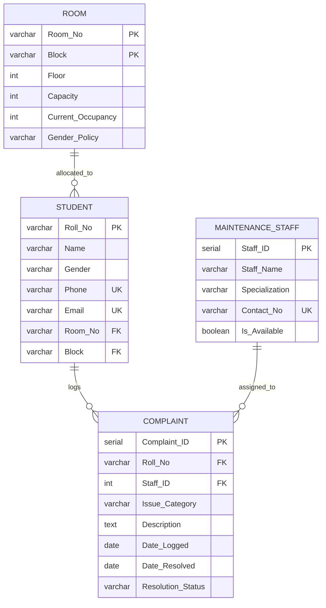
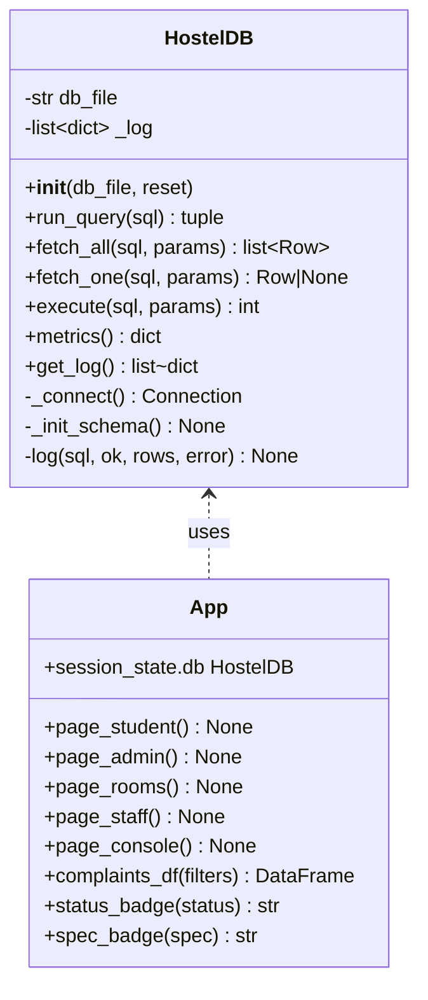
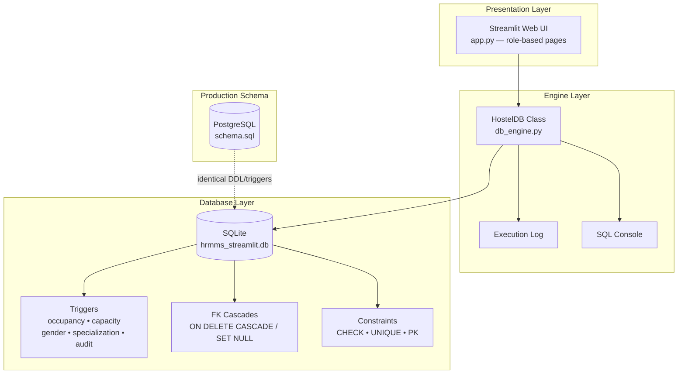
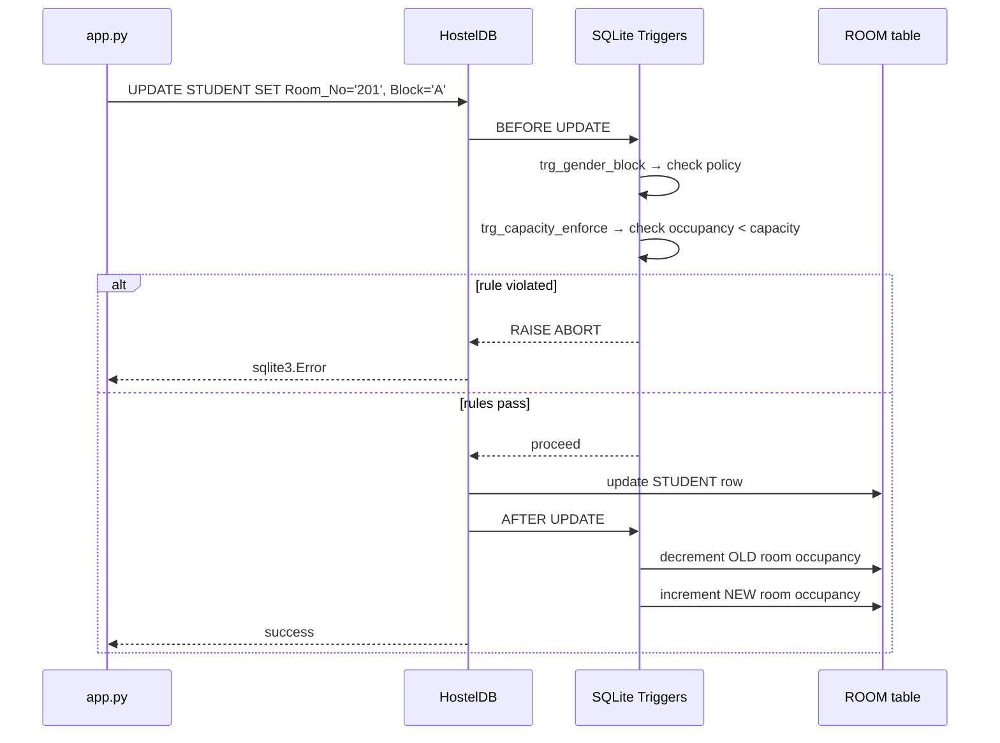
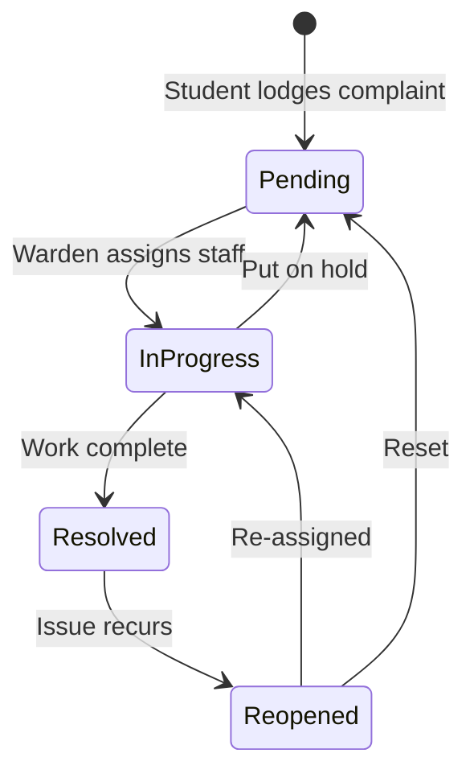

# 🏠 Hostel Room & Maintenance Management System (HRMMS)

A full-stack, submission-ready DBMS project that manages **hostel room allocations** and **maintenance complaints** with automated business rules enforced at the database layer.

The project provides a Streamlit web UI that can use SQLite by default or connect to PostgreSQL. The reference `schema.sql` contains PostgreSQL DDL and triggers.

---

## 📑 Table of Contents

1. [Features](#-features)
2. [Tech Stack](#-tech-stack)
3. [Project Structure](#-project-structure)
4. [Setup & Installation](#-setup--installation)
5. [How to Run](#-how-to-run)
6. [Database Schema](#-database-schema)
7. [Business Rules & Triggers (The Core Logic)](#-business-rules--triggers-the-core-logic)
8. [Analytical SQL Queries](#-analytical-sql-queries)
9. [Component Breakdown](#-component-breakdown)
10. [Underlying Engine Logic](#-underlying-engine-logic)
11. [UI Walkthrough (Role-Based Pages)](#-ui-walkthrough-role-based-pages)
12. [Diagrams](#-diagrams)
    - [ER Diagram](#er-diagram)
    - [Class Diagram](#class-diagram)
    - [System Architecture](#system-architecture)
    - [Trigger Execution Flow](#trigger-execution-flow)
    - [Complaint Lifecycle](#complaint-lifecycle)
13. [Testing & Verification](#-testing--verification)
14. [Report Chapter Mapping (Amrita Submission)](#-report-chapter-mapping-amrita-submission)

---

## ✨ Features

### Database Layer
- **5 relational tables** — `ROOM`, `STUDENT`, `MAINTENANCE_STAFF`, `COMPLAINT`, and `LOGIN_USER` with primary keys, foreign keys, `CHECK` constraints, and `UNIQUE` constraints.
- **5 active database triggers** that enforce business rules automatically:
  1. 🔄 Auto-sync room occupancy on student allocate / vacate
  2. 🚫 Capacity enforcement (no over-allocation)
  3. 🚻 Gender-to-block segregation (Male/Female/Coed blocks)
  4. 🔧 Staff specialization match (Electrical complaint → Electrical staff only)
  5. 📅 Audit `Date_Resolved` stamp on status change
- **Foreign-key cascades** — `ON DELETE CASCADE` (student deletion cascades to complaints), `ON DELETE SET NULL`.
- **Indexes** on frequently-queried columns for performance.

### Application Layer
- **Streamlit Web UI** with a unified sign-in screen and role-restricted navigation.
- **Role-based access** for students, wardens, and administrators. Passwords are stored as salted PBKDF2 hashes.
- **Live KPI dashboard** — occupancy %, pending complaints, available staff, etc.
- **Interactive SQL console** with preset analytical queries and an execution log.
- **Constraint verification battery** — run all 5 rule checks with one click.

---

## 🧰 Tech Stack

| Layer | Technology |
|-------|-----------|
| Frontend | Streamlit 1.65+, Pandas |
| Database Engine | SQLite (default) or PostgreSQL (Streamlit) |
| PostgreSQL Adapter | Psycopg 3 |
| Language | Python 3.10+ |

---

## 📂 Project Structure

```
Project_1/
├── schema.sql          # PostgreSQL DDL + triggers + seed data + analytical queries
├── db_engine.py        # SQLite/PostgreSQL database layer + triggers + execution log
├── app.py              # Role-based Streamlit web UI
├── migrations/         # Repeatable SQL data migrations
│   └── 001_update_student_name.sql
├── requirements.txt    # Python dependencies
└── README.md           # This file
```

> In SQLite mode, the app stores its data in `hrmms_streamlit.db` alongside the project.

---

## ⚙️ Setup & Installation

### 1. Prerequisites
- Linux with Python **3.10 or higher**
- Ubuntu/Debian: install the `python3-venv` package matching your Python version if virtual environment support is missing.

### 2. Install Dependencies

```bash
python3 -m venv .venv
source .venv/bin/activate
python3 -m pip install -r requirements.txt
```

This installs `streamlit`, `pandas`, and the PostgreSQL adapter. SQLite is included with Python.

### 3. Connect the Streamlit app to PostgreSQL (optional)

The Streamlit app uses SQLite by default. To use PostgreSQL, copy `.env.example` to `.env` and set the connection values. Put your PostgreSQL password in `.env` locally; `.env` is excluded from Git.

```bash
cp .env.example .env
nano .env
```

Set `HRMMS_DB_BACKEND=postgres`, then fill in `HRMMS_DB_HOST`, `HRMMS_DB_PORT`, `HRMMS_DB_NAME`, `HRMMS_DB_USER`, and `HRMMS_DB_PASSWORD`. The app creates its tables and triggers in a separate `hrmms` schema and seeds demo data when rows are absent. It does not run the destructive `DROP TABLE` statements in `schema.sql` against your `public` schema.

### Authentication and access

The app creates a `LOGIN_USER` table on startup. Passwords are stored as salted PBKDF2 hashes. There is no sign-up or password-reset flow.

| Role | Default username | Default password | Available pages |
|---|---|---|---|
| Admin | `admin@123` | `admin@123` | Warden Dashboard, Room Occupancy, Staff Analytics, PostgreSQL Console |
| Warden | `Warden001` | `Warden001` | Warden Dashboard |
| Student | Their `Roll_No` | Their `Roll_No` | Student Portal for that student record |

The demo credentials are seeded only when missing. Change the defaults before exposing a deployment beyond a trusted local environment. Admin accounts cannot open the Student Portal. The app links each student login directly to its student record, so a student cannot enter another roll number.

On startup, the app applies the same repeatable update recorded in `migrations/001_update_student_name.sql`, setting `AM.EN.U4CSE23001` to `Adwaith` with email `adwaithjs2003@gmail.com`.

### 4. (Optional) PostgreSQL Setup

If you want to run the production schema against a real PostgreSQL server:

```bash
# Create a database
createdb hrmms

# Apply schema, triggers, and seed data
psql -d hrmms -f schema.sql
```

---

## ▶️ How to Run

Run commands from this directory. The database files are stored alongside the application, regardless of the current working directory.

### Streamlit Web App

```bash
./run_linux.sh
```

Opens at **http://localhost:8501**

### Just Test the Engine

```bash
python3 db_engine.py
```

Prints the seeded room occupancy table and the last few execution-log entries.

---

## 🗄️ Database Schema

### Tables Overview

| Table | Primary Key | Purpose |
|-------|-------------|---------|
| `ROOM` | `(Room_No, Block)` | Physical room with capacity, occupancy, and gender policy |
| `STUDENT` | `Roll_No` | Student details + allocated room (FK to ROOM) |
| `MAINTENANCE_STAFF` | `Staff_ID` | Technician with specialization & availability |
| `COMPLAINT` | `Complaint_ID` | Maintenance request linking a student to a staff member |

### Full DDL (PostgreSQL)

```sql
CREATE TABLE ROOM (
    Room_No           VARCHAR(10) NOT NULL,
    Block             VARCHAR(10) NOT NULL,
    Floor             INT NOT NULL CHECK (Floor >= 0),
    Capacity          INT NOT NULL CHECK (Capacity > 0),
    Current_Occupancy INT DEFAULT 0,
    Gender_Policy     VARCHAR(10) NOT NULL DEFAULT 'Male'
        CHECK (Gender_Policy IN ('Male', 'Female', 'Coed')),
    CONSTRAINT PK_Room PRIMARY KEY (Room_No, Block),
    CONSTRAINT CHK_Occupancy
        CHECK (Current_Occupancy <= Capacity AND Current_Occupancy >= 0)
);

CREATE TABLE STUDENT (
    Roll_No  VARCHAR(20) PRIMARY KEY,
    Name     VARCHAR(60)  NOT NULL,
    Gender   VARCHAR(10)  NOT NULL CHECK (Gender IN ('Male', 'Female', 'Other')),
    Phone    VARCHAR(15)  UNIQUE NOT NULL,
    Email    VARCHAR(100) UNIQUE NOT NULL,
    Room_No  VARCHAR(10),
    Block    VARCHAR(10),
    CONSTRAINT FK_Student_Room FOREIGN KEY (Room_No, Block)
        REFERENCES ROOM(Room_No, Block) ON DELETE SET NULL
);

CREATE TABLE MAINTENANCE_STAFF (
    Staff_ID        SERIAL PRIMARY KEY,
    Staff_Name      VARCHAR(60) NOT NULL,
    Specialization  VARCHAR(30) NOT NULL
        CHECK (Specialization IN ('Electrical','Plumbing','Carpentry','Cleaning','Network')),
    Contact_No      VARCHAR(15) UNIQUE NOT NULL,
    Is_Available    BOOLEAN DEFAULT TRUE
);

CREATE TABLE COMPLAINT (
    Complaint_ID      SERIAL PRIMARY KEY,
    Roll_No           VARCHAR(20) NOT NULL,
    Staff_ID          INT,
    Issue_Category    VARCHAR(30) NOT NULL
        CHECK (Issue_Category IN ('Electrical','Plumbing','Carpentry','Cleaning','Network')),
    Description       TEXT NOT NULL,
    Date_Logged       DATE DEFAULT CURRENT_DATE,
    Date_Resolved     DATE,
    Resolution_Status VARCHAR(20) DEFAULT 'Pending'
        CHECK (Resolution_Status IN ('Pending','In Progress','Resolved','Reopened')),
    CONSTRAINT FK_Complaint_Student FOREIGN KEY (Roll_No)
        REFERENCES STUDENT(Roll_No) ON DELETE CASCADE,
    CONSTRAINT FK_Complaint_Staff FOREIGN KEY (Staff_ID)
        REFERENCES MAINTENANCE_STAFF(Staff_ID) ON DELETE SET NULL
);

CREATE INDEX idx_student_room     ON STUDENT(Room_No, Block);
CREATE INDEX idx_complaint_roll   ON COMPLAINT(Roll_No);
CREATE INDEX idx_complaint_staff  ON COMPLAINT(Staff_ID);
CREATE INDEX idx_complaint_status ON COMPLAINT(Resolution_Status);
```

---

## 🧠 Business Rules & Triggers (The Core Logic)

All business rules are enforced **inside the database** via triggers — not in application code. This guarantees consistency even if a user runs raw SQL.

### Trigger 1 — Auto-Sync Room Occupancy

Increments `Current_Occupancy` when a student is allocated, decrements when vacated/moved.

```sql
CREATE OR REPLACE FUNCTION update_room_occupancy_fn()
RETURNS TRIGGER AS $$
BEGIN
    IF (TG_OP = 'INSERT' AND NEW.Room_No IS NOT NULL) THEN
        UPDATE ROOM SET Current_Occupancy = Current_Occupancy + 1
         WHERE Room_No = NEW.Room_No AND Block = NEW.Block;

    ELSIF (TG_OP = 'UPDATE') THEN
        IF (OLD.Room_No IS DISTINCT FROM NEW.Room_No OR OLD.Block IS DISTINCT FROM NEW.Block) THEN
            IF OLD.Room_No IS NOT NULL THEN
                UPDATE ROOM SET Current_Occupancy = Current_Occupancy - 1
                 WHERE Room_No = OLD.Room_No AND Block = OLD.Block;
            END IF;
            IF NEW.Room_No IS NOT NULL THEN
                UPDATE ROOM SET Current_Occupancy = Current_Occupancy + 1
                 WHERE Room_No = NEW.Room_No AND Block = NEW.Block;
            END IF;
        END IF;

    ELSIF (TG_OP = 'DELETE' AND OLD.Room_No IS NOT NULL) THEN
        UPDATE ROOM SET Current_Occupancy = Current_Occupancy - 1
         WHERE Room_No = OLD.Room_No AND Block = OLD.Block;
    END IF;
    RETURN NEW;
END;
$$ LANGUAGE plpgsql;

CREATE TRIGGER trg_sync_room_occupancy
AFTER INSERT OR UPDATE OR DELETE ON STUDENT
FOR EACH ROW EXECUTE FUNCTION update_room_occupancy_fn();
```

### Trigger 2 — Capacity Enforcement

Prevents allocating a student to a room that is already full.

```sql
-- (BEFORE trigger on STUDENT insert/update)
IF v_current + 1 > v_capacity THEN
    RAISE EXCEPTION 'Room %-% is full (capacity %).', NEW.Block, NEW.Room_No, v_capacity;
END IF;
```

### Trigger 3 — Gender-to-Block Segregation

A student may only be placed in a block whose `Gender_Policy` matches their gender (Coed blocks allow both).

```sql
IF v_policy <> 'Coed' AND v_policy <> NEW.Gender THEN
    RAISE EXCEPTION 'Block % is restricted to % students; cannot allocate % student.',
          NEW.Block, v_policy, NEW.Gender;
END IF;
```

### Trigger 4 — Staff Specialization Match

A complaint can only be assigned to a technician whose `Specialization` equals the complaint's `Issue_Category`.

```sql
IF v_spec IS DISTINCT FROM NEW.Issue_Category THEN
    RAISE EXCEPTION 'Staff % is specialized in % but complaint is %%.',
          NEW.Staff_ID, v_spec, NEW.Issue_Category;
END IF;
```

### Trigger 5 — Audit Date_Resolved

Auto-stamps `Date_Resolved = CURRENT_DATE` when status becomes `'Resolved'`; clears it when reopened.

```sql
IF NEW.Resolution_Status = 'Resolved' THEN
    NEW.Date_Resolved := CURRENT_DATE;
ELSE
    NEW.Date_Resolved := NULL;
END IF;
```

> The SQLite engine (`db_engine.py`) implements the same checks using SQLite `BEFORE`/`AFTER` triggers with `RAISE(ABORT, ...)`. It uses fixed, descriptive error text so it remains compatible with Ubuntu's SQLite 3.46 and earlier.

---

## 📊 Analytical SQL Queries

These satisfy the query-complexity requirement (joins, aggregations, `GROUP BY`, `HAVING`).

### Q1 — Vacancy Detection (available beds per room)

```sql
SELECT Block, Room_No, Floor, Capacity, Current_Occupancy,
       (Capacity - Current_Occupancy) AS Available_Beds
FROM ROOM
WHERE Current_Occupancy < Capacity
ORDER BY Block, Floor, Room_No;
```

### Q2 — Staff Workload Metric

```sql
SELECT s.Staff_ID, s.Staff_Name, s.Specialization,
       COUNT(c.Complaint_ID) AS Total_Assigned,
       COUNT(CASE WHEN c.Resolution_Status <> 'Resolved' THEN 1 END) AS Active_Tasks
FROM MAINTENANCE_STAFF s
LEFT JOIN COMPLAINT c ON s.Staff_ID = c.Staff_ID
GROUP BY s.Staff_ID, s.Staff_Name, s.Specialization;
```

### Q3 — Room-wise Complaint Frequency

```sql
SELECT st.Block, st.Room_No, COUNT(c.Complaint_ID) AS Total_Complaints
FROM COMPLAINT c
JOIN STUDENT st ON c.Roll_No = st.Roll_No
GROUP BY st.Block, st.Room_No
HAVING COUNT(c.Complaint_ID) >= 1
ORDER BY Total_Complaints DESC;
```

### Q4 — Aging Report (open complaints older than 3 days)

```sql
SELECT Complaint_ID, Roll_No, Issue_Category, Date_Logged,
       (CURRENT_DATE - Date_Logged) AS Days_Open
FROM COMPLAINT
WHERE Resolution_Status <> 'Resolved'
ORDER BY Days_Open DESC;
```

### Q5 — Block Occupancy Rate

```sql
SELECT Block,
       SUM(Capacity) AS Total_Beds,
       SUM(Current_Occupancy) AS Occupied,
       ROUND(100.0 * SUM(Current_Occupancy) / NULLIF(SUM(Capacity), 0), 2) AS Occupancy_Pct
FROM ROOM
GROUP BY Block
ORDER BY Block;
```

---

## 🔩 Component Breakdown

### `db_engine.py` — The Heart

| Component | Description |
|-----------|-------------|
| `SCHEMA_SQL` | DDL + all 5 triggers in SQLite dialect |
| `SEED_SQL` | Sample rooms, students, staff, complaints |
| `HostelDB` class | Stateful wrapper: connection management, `run_query()`, execution log, `metrics()` |
| `get_db()` | Module-level singleton factory |

**Key methods of `HostelDB`:**

| Method | Returns | Purpose |
|--------|---------|---------|
| `run_query(sql)` | `(columns, rows, rows_affected, error)` | Generic SQL console (SELECT / INSERT / UPDATE / DELETE) |
| `fetch_all(sql, params)` | `list[Row]` | Read rows |
| `fetch_one(sql, params)` | `Row \| None` | Read single row |
| `execute(sql, params)` | `int` | Execute DML, return rows affected |
| `metrics()` | `dict` | All KPI numbers (occupancy, complaints, staff) |
| `get_log()` | `list[dict]` | Timestamped execution log |

### `app.py` — Streamlit UI

- Uses `st.session_state` to keep the `HostelDB` instance persistent across reruns.
- Sidebar: navigation + live KPI cards + reset button.
- 5 page functions: `page_student()`, `page_admin()`, `page_rooms()`, `page_staff()`, `page_console()`.
- Status badges and specialization badges rendered via inline HTML/CSS.

### `schema.sql` — PostgreSQL Reference

- Drop-in schema for a real PostgreSQL instance (plpgsql triggers).

---

## ⚙️ Underlying Engine Logic

### How a Complaint Submission Flows

```
User clicks "Submit Complaint"
        │
        ▼
app.py  →  db.execute("INSERT INTO COMPLAINT ...")
        │
        ▼
db_engine.py  →  sqlite3 connection (PRAGMA foreign_keys=ON)
        │
        ▼
SQLite fires BEFORE INSERT trigger (trg_staff_spec_insert)
   → if Staff_ID set and specialization mismatch → RAISE ABORT
        │
        ▼
Row inserted → FK checks run (Roll_No must exist in STUDENT)
        │
        ▼
Execution log updated → UI refreshes
```

### How Room Allocation Flows

```
User allocates student to room
        │
        ▼
UPDATE STUDENT SET Room_No=?, Block=?
        │
        ▼
BEFORE triggers fire:
   1. trg_gender_block_update   → reject if gender policy mismatch
   2. trg_capacity_enforce_update → reject if room is full
        │
        ▼
AFTER trigger fires:
   trg_student_occupancy_update → decrement OLD room, increment NEW room
        │
        ▼
Current_Occupancy is always consistent — no application code needed
```

### Why SQLite Can Emulate These PostgreSQL Triggers

| PostgreSQL | SQLite Equivalent |
|------------|-------------------|
| `plpgsql` function + `EXECUTE FUNCTION` | `CREATE TRIGGER ... BEGIN ... END` |
| `RAISE EXCEPTION` | `SELECT RAISE(ABORT, 'msg')` |
| `TG_OP`, `OLD`, `NEW` | `OLD.col`, `NEW.col` (SQLite triggers) |
| `BEFORE UPDATE OF col` | `BEFORE UPDATE OF col` (supported) |

---

## 🖥️ UI Walkthrough (Role-Based Pages)

### Student Portal (Student role)
- Profile card is bound to the authenticated student's roll number (name, gender, room, email).
- Complaint form: category dropdown, priority, description.
- Submit → row inserted (status `Pending`).
- Complaint history table with colored status pills.

### Warden Dashboard (Warden and Admin roles)
- KPI cards: total / pending / in-progress / resolved.
- Filters by status and category.
- Action panel for a selected complaint:
  - Specialization-aware staff assignment with a matching or no-match message.
  - 1-click buttons: **In Progress**, **Resolve**, **Reopen**.

### Room Occupancy & Allocations (Admin role)
- KPIs: total rooms, beds, available beds, occupancy %.
- Allocate / Vacate modal (enforces gender + capacity at DB level).
- Floor-by-floor block grid: each room card shows occupancy bar + "N free" badge.
  - Accent borders distinguish vacant, partially occupied, and full rooms.
- Expandable full room table.

### Staff Analytics & Workload (Admin role)
- Per-staff cards: name, specialization badge, total/active/resolved task counts, availability toggle.
- Bar chart of active vs resolved tasks per technician.

### PostgreSQL Console (Admin role)
- **SQL Terminal**: free-form query editor + preset queries (Q1–Q5). Returns DataFrames for SELECT.
- **DDL Schema**: displays the project PostgreSQL schema plus live table, index, and trigger definitions from the configured database backend.
- **Constraint Log**: one-click battery that runs all 5 rule checks and shows PASS/FAIL.
- **Execution Log**: last 50 operations with timestamp, status, and error messages.

---

## 📐 Diagrams

### ER Diagram



### Class Diagram



### System Architecture



### Trigger Execution Flow



### Complaint Lifecycle



---

## ✅ Testing & Verification

The Streamlit **PostgreSQL Console → Constraint Log** tab runs this battery with one click:

| # | Check | Expected |
|---|-------|----------|
| 1 | Insert student into full room A-101 | ❌ Blocked — *"Room is full."* |
| 2 | Insert Male student into Female block C | ❌ Blocked — *"Gender policy violation..."* |
| 3 | Assign Plumbing staff to Electrical complaint | ❌ Blocked — *"Staff specialization does not match complaint category."* |
| 4 | FK ON DELETE CASCADE declared on COMPLAINT.Roll_No | ✅ DDL declared |
| 5 | Set complaint status to Resolved | ✅ `Date_Resolved` auto-stamped |

Expected result: **5/5 PASS**.

---

## 📝 Report Chapter Mapping (Amrita Submission)

| Chapter | Content |
|---------|---------|
| **3. System Requirements** | Business rules (Section above) + role matrix (Student, Warden, Staff) |
| **4. Conceptual Model** | ER Diagram (above) — Room ↔ Student (1:N), Staff ↔ Complaint (1:N), Student ↔ Complaint (1:N) |
| **5. Relational Schema & BCNF** | 4 tables, FDs, all determinants are superkeys → BCNF |
| **6. SQL Implementation** | `schema.sql` DDL + 5 triggers + 5 analytical queries |
| **7. UI & System Integration** | Screenshots of the Streamlit 5-tab interface |
| **8. Testing & Verification** | Constraint verification table (above) |

---

## 📜 License

Academic project — free to use for educational purposes.
